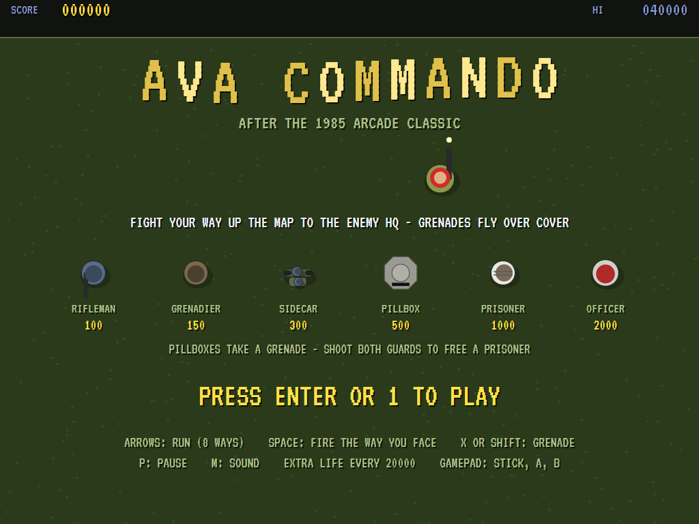
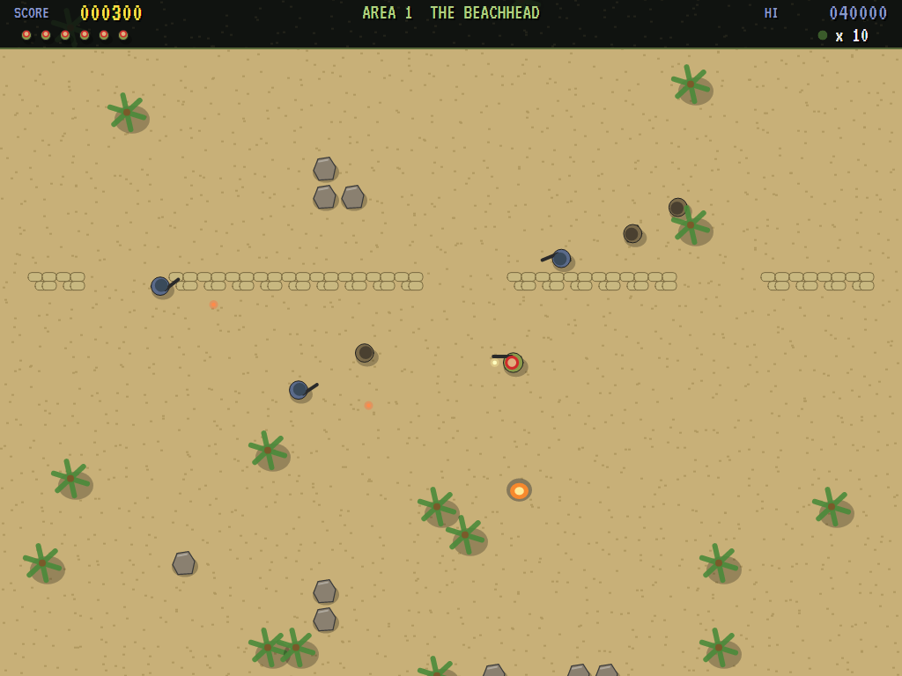
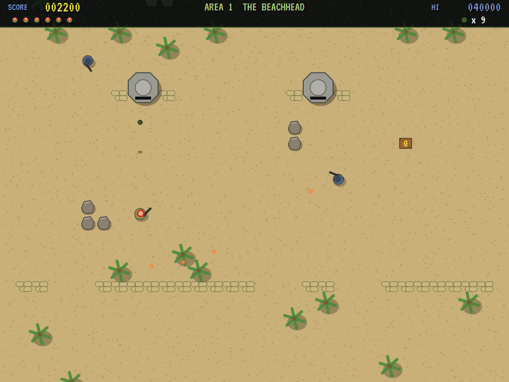
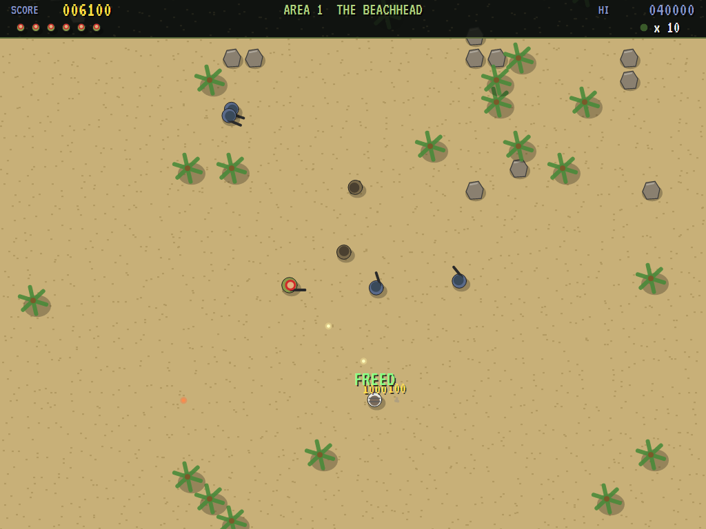
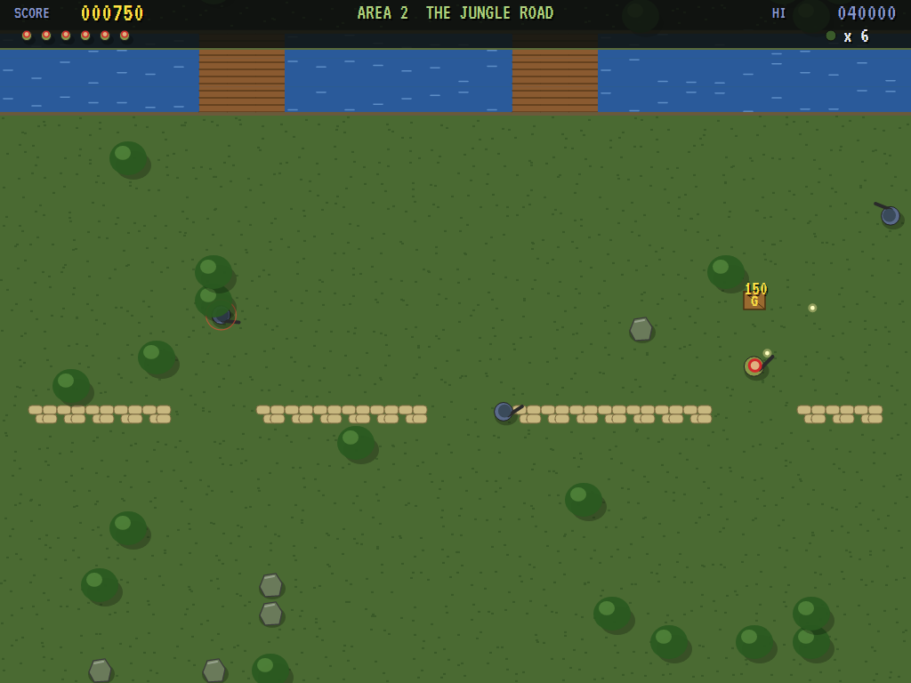
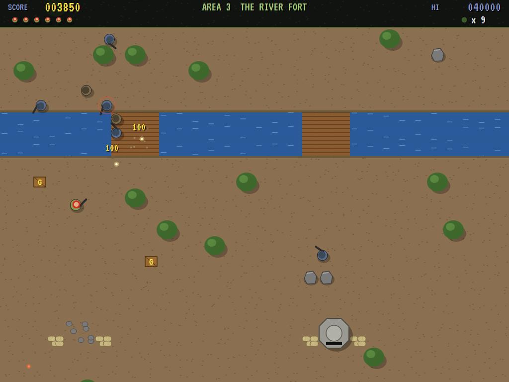
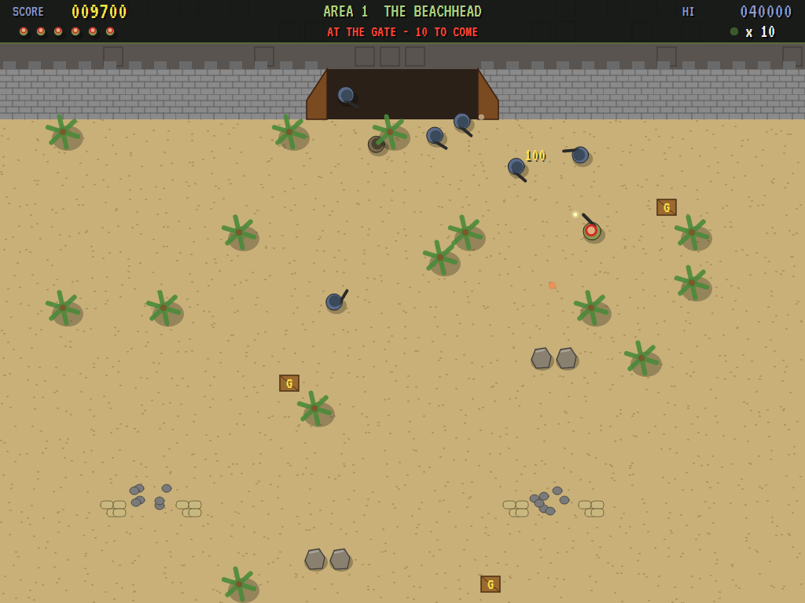
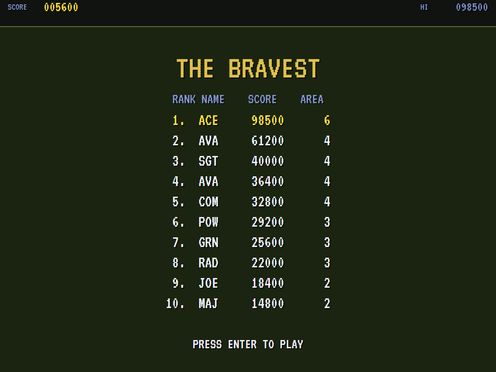

# AVA Commando

[](https://github.com/Harlock123/AVACommando/actions/workflows/build.yml)

A run-and-gun war game in the style of Capcom's 1985 arcade game **Commando**, built with .NET 10 and
Avalonia UI. One soldier fights his way up a scrolling battlefield to the enemy's fort. He runs eight ways,
fires the way he faces, and lobs grenades over the cover the enemy hides behind. Along the way are
pillboxes to blow up, prisoners to free, and sidecars racing across. Each area ends at the fort's gate,
where the enemy pours out to stop you.

## Features

- **The commando** runs eight ways at one speed and fires the way he last ran: three shots at a time, not
  far. **Grenades** are always thrown up the screen, over walls, sandbags and rivers, and go off where they
  land. He starts with six; crates on the ground give four more.
- **The ground** stops him and the bullets alike:
  - rocks, stone walls and lines of sandbags with gaps in them
  - rivers with two bridges (bullets fly over water; he has to cross on a bridge)
  - trees that he and the enemy pass under, half hidden
- **The enemy:**
  - **Riflemen** (100) run to a spot near you, stop, aim and fire.
  - **Grenadiers** (150) keep further off and lob grenades over cover.
  - **Sidecars** (300) race across, the passenger dropping a grenade as they pass.
  - **Pillboxes** (500) fire a spread of three. Bullets don't touch them: only a grenade will do.
  - **Guards** (100) march a **prisoner** across the map. Shoot both and he's free (1000).
  - Run into anyone and you're done.
- **Three kinds of country**, in turn: the **Beachhead** (sand and palms), the **Jungle Road** (thick trees
  and rivers) and the **River Fort** (walls, rivers and pillboxes). Each area is the same every time you
  play it, and longer and busier than the last.
- **The fort's gate** ends each area. The screen stops and the enemy rushes out of the gate, more each area.
  When the rush is beaten, the **officer** makes a run for it (2000 if you stop him). Then the area is
  taken, for a bonus.
- **The enemy keeps coming** as you advance, and slowly even if you don't. Each area brings faster
  soldiers, better shots and more at a time. There's an extra life every 20000.
- **The attract mode** plays itself through each area in turn. The computer player:
  - lines enemies up along one of the eight ways, turns to face them, and fires
  - makes its way up the map round what's in the way
  - goes to stand a grenade's throw below a pillbox to take it out
  - steps out of the way of bullets, grenades and sidecars
- **The sounds** are all synthesised: rifle cracks, grenade blasts, bugle calls, and a marching drum theme.

## Screenshots

| The title | The Beachhead | A pillbox |
|:---------:|:-------------:|:---------:|
|  |  |  |
| The enemy, and the points. | Riflemen behind the palms. | A grenade on its way. |

| A prisoner freed | The Jungle Road | The River Fort |
|:----------------:|:---------------:|:--------------:|
|  |  |  |
| Both guards down. | Sandbags and a river ahead. | Fighting at the bridge. |

| The fort's gate | The high scores | |
|:---------------:|:---------------:|:-:|
|  |  | |
| The rush. | The bravest. | |

The screenshots are made by the tests, which play the game in a real (headless) window; see
[Tests](#tests).

## Download and run

Ready-to-run builds for Windows, macOS and Linux, on both Intel/AMD and ARM, are on the
[Releases page](https://github.com/Harlock123/AVACommando/releases/tag/latest). **Latest build** is
rebuilt on every push to `main`. Each download is one self-contained executable: no .NET install is
needed.

| Platform | Archive |
|---|---|
| Windows | `AVACommando-win-x64.zip`, `AVACommando-win-x86.zip`, `AVACommando-win-arm64.zip` |
| macOS | `AVACommando-osx-arm64.tar.gz` (Apple silicon), `AVACommando-osx-x64.tar.gz` (Intel) |
| Linux | `AVACommando-linux-x64.tar.gz`, `AVACommando-linux-arm64.tar.gz`, `AVACommando-linux-arm.tar.gz` |

```bash
tar -xzf AVACommando-linux-x64.tar.gz     # or linux-arm64, linux-arm, osx-arm64, osx-x64
./AVACommando
```

On Windows, unzip and run `AVACommando.exe`. On macOS, if Gatekeeper refuses to open it, run
`xattr -d com.apple.quarantine AVACommando` once. Run with `--no-audio` for silence.

**Sound** comes through OpenAL Soft, built in for every platform. In a virtual machine the game
detects it and uses a larger audio buffer, so the sound doesn't break up.

**Gamepads** use SDL2, which is bundled for Windows, macOS and Intel/AMD Linux. ARM Linux builds need it
installed; without it the keyboard still works:

```bash
sudo apt install libsdl2-dev            # Debian / Ubuntu / Raspberry Pi OS
sudo pacman -S --needed sdl2-compat     # Arch / Omarchy
```

## Controls

| Action | Keyboard | Gamepad |
|---|---|---|
| Start | Enter or 1 | Start |
| Run (eight ways) | Arrow keys (or W A S D) | Left stick / D-pad |
| Fire (the way you face) | Space, Z or Ctrl | A or right trigger |
| Grenade (up the screen) | X, C or Shift | B, X or left trigger |
| Pause | P or Esc | Start |
| Quit (while paused) | Esc | Back |
| Sound on/off | M | |
| Screenshot | Ctrl+S (to your Pictures folder) | |

On the high-score table, type your initials, or use up/down and Space, then Enter.

## Tests

```bash
dotnet test AVACommando.slnx
```

The engine has no UI and runs in fixed 60 Hz steps, so it plays the same at any frame rate, and a seed
always plays the same game. The tests check:

- **The map:** every area a way up through its ground to the fort's gate, with its pillboxes and prisoner,
  the same each time, and the three kinds of country in turn
- **The commando:**
  - running eight ways at one speed and facing the way he ran
  - rocks and water stopping him, and bridges not
  - firing the way he faces, three at most, not far
  - sandbags stopping bullets and water not
  - grenades going up the screen over a wall and taking out whoever is where they land
  - none when he's out, and four from a crate
- **The enemy:**
  - a pillbox shrugging off bullets, firing its spread, and falling to a grenade
  - a rifleman running, stopping, aiming and firing
  - a grenadier's lob
  - running into a soldier or a sidecar, and shooting a sidecar
  - freeing a prisoner by shooting both guards
- **The machine:**
  - the screen following him up but never back
  - the enemy in the map coming on as the screen reaches it
  - the rush at the gate, the officer, and the area taken
  - extra lives, the last life, and initials
  - the title, demonstration and high scores, and starting a game
  - the computer player taking the first area
  - the same game from the same seed, and pausing

The screenshot tests draw the real screen in a headless window. To refresh the README's pictures:

```bash
COMMANDO_SHOTS=$PWD/Images dotnet test tests/AVACommando.Tests --filter ScreenshotTests
```

To see how the computer player gets on, area by area (the march to the gate, and the fight there; `1` for the
pilot, `lazy` for one that just runs up the screen firing ahead):

```bash
COMMANDO_PROBE=1 dotnet test tests/AVACommando.Tests --filter PilotProbe --logger "console;verbosity=detailed"
```

## Building

```bash
dotnet build AVACommando.slnx
dotnet run --project src/AVACommando
```

Needs the .NET 10 SDK. The sounds are made by `tools/make_sounds.py` (standard-library Python):
`python3 tools/make_sounds.py` rewrites `src/AVACommando/Sounds`.

## Project structure

```
AVACommando/
├── AVACommando.slnx
├── src/AVACommando/
│   ├── Engine/
│   │   ├── GameEngine.cs        # States, the title and demo cycle, the march
│   │   ├── GameEngine.Play.cs   # The commando, his rifle and grenades; the scrolling; the enemy and its
│   │   │                        # reinforcements; pillboxes, prisoners and sidecars; the gate; scoring
│   │   ├── CommandoPilot.cs     # The computer player, for the demonstration (and the tests)
│   │   ├── Entities.cs          # The areas and how their maps are built; the soldiers and everything else
│   │   ├── HighScoreTable.cs, InitialsEntry.cs
│   │   ├── InputHandler.cs, ControllerManager.cs  # Keys and an SDL2 gamepad
│   │   └── SoundManager.cs      # Effects and the tunes through OpenAL
│   ├── Audio/                   # The OpenAL engine (from the author's AVABand)
│   ├── Views/                   # The drawing: the ground, the soldiers, the fort and the screens
│   └── Sounds/                  # The synthesised effects and tunes
├── tests/AVACommando.Tests/     # Gameplay, screenshot and probe tests
├── tools/make_sounds.py
└── Images/                      # Screenshots
```

## About and licence

AVA Commando © 2026 Lonnie Watson, under the [MIT License](LICENSE).

*Commando* © 1985 Capcom; the name belongs to its current owner. AVA Commando is an independent,
unofficial game in its style. Its soldier, its maps, enemies and fort, its graphics, sounds, tunes and code
are its own; nothing is taken from the arcade machine's program, graphics, sound or music. It is not
affiliated with or endorsed by any rights holder.
